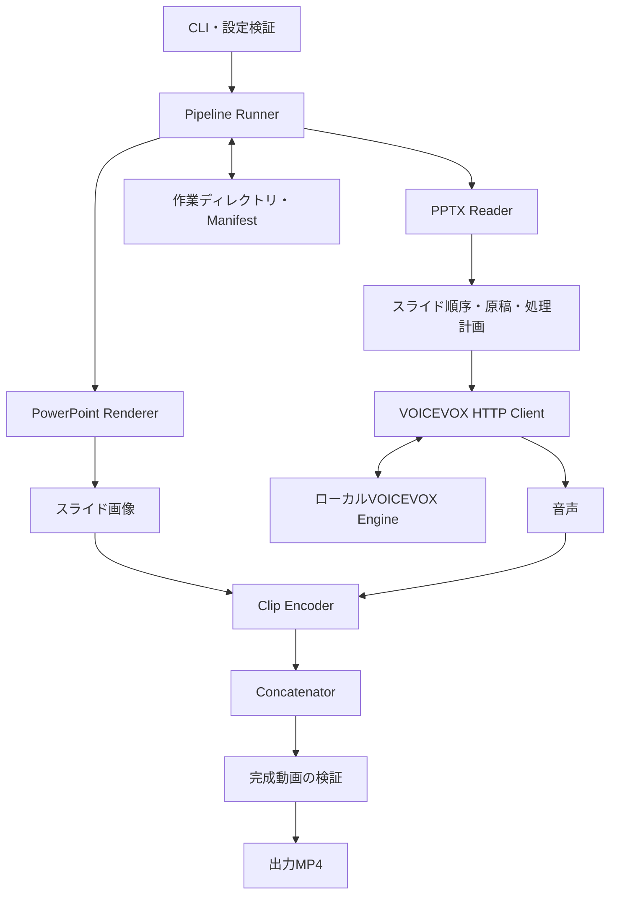

# DeckReel 設計書

[要件](requirements.md)（PR #1で導入）に対応する初期設計。
設計段階の文書であり、実装済み・Mac実機で検証済みであることを意味しない。
音声合成はVOICEVOXを採用する方針に要件を更新し、実装の責務、データ、再実行の規則を定義する。

## 1. 設計方針

Go製CLIを処理全体の制御役とし、PPTXの解析、スライドごとの状態管理、外部機能の呼び出しを分離する。
処理は逐次実行する。画像化はプレゼンテーション全体の書き出しになってもよいが、音声と動画の再利用はスライド単位で判断する。

| 項目 | 設計方針 | 状態 |
| --- | --- | --- |
| 本体 | Go、標準ライブラリを中心に構成 | 採用方針 |
| ノート抽出 | ZIP/XMLを直接読み、PowerPointの画面操作から分離 | 採用方針 |
| スライド描画 | macOS版PowerPointを自動操作 | 実機検証が必要 |
| 音声 | ローカルのVOICEVOX EngineへHTTP接続 | 採用方針。対応バージョン・品質を検証 |
| 動画処理 | FFmpeg系のアダプターを第一候補 | 採否・配布構成は未確定 |
| 配布 | 1つの実行ファイル。必要な補助実行物は埋め込み・展開を検討 | 署名・ライセンス等を検証 |

GUI、Webサービス、並列ジョブ、アニメーション再現、クラウド音声連携は初期設計に含めない。

## 2. 全体構成



### 責務

| モジュール候補 | 入力 | 出力・責務 |
| --- | --- | --- |
| `cmd/deckreel` | 引数 | 設定検証、進捗表示、終了コード |
| `internal/pptx` | 入力のスナップショット | 順序、安定ID、表示可否、サイズ、ノート本文 |
| `internal/powerpoint` | PPTX、対象スライド | 元スライドIDに対応した画像一覧 |
| `internal/script` | ノート、辞書 | 正規化した読み上げ原稿 |
| `internal/speech` | 原稿、声、速度 | 音声、実測長、エンジン識別情報 |
| `internal/media` | 画像、音声、動画設定 | クリップ生成、検査、結合 |
| `internal/cache` | 工程キー、成果物 | ハッシュ検証、Manifestの保存、排他制御 |
| `internal/pipeline` | 設定と上記機能 | 計画、実行、再開、キャンセル |
| `internal/runtime` | 埋め込みリソース | 補助実行物の検証と展開 |

アダプターはGoの小さなインターフェースで抽象化する。プロセス起動は引数配列で行い、シェル文字列の組み立てに資料名や台本を埋め込まない。

## 3. CLI案

以下は未実装のインターフェース案。サブコマンドを増やさず、1回の実行で変換する。

```sh
deckreel presentation.pptx --output output.mp4
deckreel presentation.pptx --output output.mp4 --speaker <style-id> --speed 1.0
deckreel presentation.pptx --output output.mp4 --dictionary readings.json --work-dir ./work/demo
```

| オプション | 意味・既定 |
| --- | --- |
| `--output` | 出力先。省略時は入力と同じ場所の同名MP4 |
| `--work-dir` | 中間成果物。省略時は入力ディレクトリの `work/<入力名>-<絶対パスの短いハッシュ>/` |
| `--voicevox-url` | Engineの接続先。既定 `http://127.0.0.1:50021`。初期版はローカル接続のみ |
| `--speaker` | VOICEVOXのスタイルID。音声生成が必要な場合は必須。名前・スタイルを確認して記録 |
| `--speed` | `speedScale`に対応する倍率。既定1.0。対応範囲はEngine仕様に従って検証 |
| `--dictionary` | 順序付きの読み置換辞書JSON |
| `--empty-notes` | `silence`（既定）または `skip` |
| `--silence-seconds` | 空ノートの表示秒数、既定3 |
| `--tail-seconds` | 読み上げ後の余白、既定0.5 |
| `--overwrite` | 完成動画の既存出力を置換する許可 |

通常の再実行でキャッシュを利用する。初期版では対象スライド指定・強制再生成オプションは必須にしない。
秒数・速度の不正値、入力と出力の同一パス、書き込み不能な場所は実処理前に拒否する。
進捗は標準エラーに工程とスライド位置を表示し、成功時に標準出力へ出力先を表示する。原稿本文は通常ログに出さない。

## 4. PPTX解析とPowerPoint連携

### PPTX Reader

1. 入力を作業領域へスナップショットとしてコピーし、SHA-256を計算する。コピー中の入力変更を検出したらやり直しを案内する。
2. `ppt/presentation.xml` の `p:sldIdLst` とrelationshipsをたどり、実際の表示順序を得る。ZIP内のファイル名の数値順には依存しない。
3. スライドの `show` 属性から非表示を判定し、対象から除く。
4. スライドのrelationshipsからnotesSlideを解決する。ノート本文プレースホルダー内の段落・テキストを順序どおりに抽出し、段落や明示改行を保持する。
5. スライド番号、日付、ヘッダー、フッター、画像は原稿に含めない。ノート欠落は空原稿として扱う。

相対relationshipはパッケージ内で正規化し、外部参照を取得しない。不正な参照や解析不能なXMLは黙って欠落させずエラーとする。
ZIPを無条件に全展開せず、展開サイズ・エントリー数の上限を設ける。
スライドの安定IDにはPPTX内の `p:sldId/@id` を使い、表示順序は別フィールドで保持する。別資料のIDとは混同しない。

### PowerPoint Renderer

PowerPointのスクリプティング機能を `osascript` 等のmacOS標準手段から呼び出す案を検証する。
AppleScriptの具体的な命令は、インストール済みPowerPointの辞書と実機結果に基づいて決める。

- 自分で作ったスナップショットだけを開き、ユーザーが開いている資料を保存・閉鎖しない。
- 自分の処理で開いた資料だけを保存せず閉じる。PowerPoint全体を強制終了しない。
- PDF一括書き出しとスライド直接画像出力を比較する。PDF経由の場合、PDFからの画像化機能も標準機能または同梱物で提供する。
- 非表示スライドを含む書き出し挙動とページ番号の対応を実機で確認する。ページ数が一致しても対応が曖昧なら処理を止める。
- 得られた画像は1920×1080の黒いキャンバスへ縦横比を保って配置する。低解像度画像の単なる拡大を標準経路にしない。
- フォント環境、PowerPointと描画処理のバージョンをキャッシュ条件に含める。フォント変更を検出できない場合の明示的なキャッシュ破棄手段を実装時に用意する。

原稿だけの変更でもPowerPointでの全体書き出しが再度必要になる可能性はある。正規化した画素のハッシュが同一なら既存画像と後続成果物を再利用する。

## 5. 原稿・音声

原文と読み上げ用原稿を別々に保持する。原文 → 改行・空白の整理 → 辞書置換の順とし、句読点や専門用語を推測で変えない。
辞書は以下の順序付き形式を候補とする。

```json
[
  {"from": "Kubernetes", "to": "クバネティス"},
  {"from": "API", "to": "エーピーアイ"}
]
```

空の置換元は拒否する。各ルールを配列順に1回ずつ全文へ適用するため、前の置換結果は後のルールの対象になり得る。再帰的な反復置換は行わない。
正規化前から本文が空のスライドに空ノート設定を適用し、辞書適用で読み上げ原稿が空になった場合も同じ規則で扱う。

### VOICEVOX連携

音声合成は利用者が別途起動するローカルのVOICEVOX Engineを使用する。macOS標準の読み上げは採用せず、接続失敗時の代替にも使わない。
DeckReelからEngineやモデルのインストール・起動・終了は行わない。

1. 対応するEngineのバージョン、話者・スタイル一覧を取得し、指定されたスタイルIDを検証する。
2. スライドごとの原稿を `POST /audio_query` に渡し、AudioQueryを得る。
3. 返されたクエリーへ `speedScale` 等の実効設定を反映する。
4. `POST /synthesis` にクエリーとスタイルIDを渡し、WAVを取得する。
5. WAVを検査し、48kHz・モノラルPCMに統一する。尺は実際のサンプル数から求める。

上記はAPI接続案であり、採用するEngineのOpenAPI定義でパラメーター・応答・対応範囲を確認してから実装する。
HTTP要求にタイムアウトとキャンセルを設け、HTTPエラーや不正WAVを成功扱いしない。
未起動・非対応バージョン・指定スタイル欠落時は理由と対処を表示して停止する。
原稿はローカルEngineにのみ渡し、URLクエリーを含む要求全文や原稿本文を通常ログに記録しない。外部ホストへのリダイレクトも追従しない。

原稿・生成クエリー・WAVを保存し、話者名、スタイル名・ID、Engine情報、モデル識別情報、実効クエリーのハッシュを記録する。
音声キャッシュはEngine・モデル・設定が変われば無効化する。取得できないモデル情報がある場合、利用者が指定するモデル改訂識別子を設け、不明な環境での再利用を避ける。
Engineのユーザー辞書を参照する場合は辞書内容のハッシュも条件に含める。DeckReelから共有のEngine辞書は変更しない。
長文の制限と分割の必要性は対応Engineで検証し、原稿を黙って切り捨てない。

話者・スタイルは自動で別のものに変更しない。利用者が選んだ音声の利用条件に従えるよう、ローカルの利用情報ファイルに音声名とクレジット候補を保存する。
クレジット表記や利用条件は音声ごとに確認し、動画への自動焼き込みは初期版に含めない。

## 6. 動画と時間の扱い

動画処理はFFmpeg/ffprobe相当のエンコード・検査機能を持つアダプターに集約する。
FFmpeg採用時の候補はVideoToolboxのH.264エンコーダーとAAC。具体的なビルドと利用可否は配布検証で決め、利用不可なら明確なエラーにする。
未検証のエンコーダーへ自動で切り替えない。

- 映像：1920×1080、30fps固定、H.264、yuv420p。
- 音声：AAC、48kHz、モノラル。無音スライドにも音声ストリームを持たせる。
- 通常スライドのフレーム数：`ceil((音声秒数 + tail秒数) × 30)`。
- 空ノートのフレーム数：`ceil(silence秒数 × 30)`。tailは加算しない。
- フレーム数から決まる表示時間まで音声を無音で埋める。丸め計算はサンプル数と整数・有理数を基準にして末尾切れを避ける。
- 各クリップのタイムスタンプはゼロから開始し、コーデック設定・time base・音声構成を統一する。

結合前に各クリップの実測情報とストリーム互換性を確認し、互換なら順序どおりにストリームコピーする。
AACのエンコーダー遅延やパケット境界による差はフレーム丸めだけでは解決しないため、長い連続結合で無音・重なり・累積ずれを測る。
初期の評価目標は各境界・全体の表示時間の誤差1フレーム以内とし、音声末尾が切れないことを必須とする。
この条件を満たせない場合は配布を保留し、音声を結合後に一度だけエンコードする等の代案を検討する。ストリームコピーの目標変更は要件へ反映してから行う。

## 7. 中間データとキャッシュ

作業ディレクトリはローカル成果物で、Gitに登録しない。以下は実装時の構成案。

```text
work/<project>/
  manifest.json
  input/presentation.pptx
  slides/<stable-slide-id>/
    source.txt
    script.txt
    image.png
    audio_query.json
    audio.wav
    clip.mp4
  tmp/
```

Manifestにはスキーマ版、入力ハッシュ、処理版、環境識別情報、実効設定、対象スライドの順序を記録する。
各工程に状態、入力キー、成果物の相対パス・ハッシュ・サイズ、実測メタデータ、エラーを持たせる。
絶対パスはキャッシュの内容識別に使わず、生成物パスは作業ディレクトリ配下に限定する。

### 工程キー

キーはバージョン付きの正規化JSONと内容のSHA-256から作る。更新日時だけで再利用を決めない。

| 工程 | 主なキーの材料 |
| --- | --- |
| PPTX解析 | 入力PPTXハッシュ、解析処理版 |
| 全体書き出し | 入力PPTXハッシュ、描画環境、書き出し設定・処理版 |
| 原稿 | 原文、正規化処理版、順序付き辞書 |
| 音声 | 読み上げ原稿、実効スタイル・speed、Engine・モデル・Engine辞書の識別情報、PCM設定・処理版 |
| クリップ | 正規化画像ハッシュ、音声ハッシュまたは空ノート秒数、tail、映像・音声設定、エンコーダー情報・処理版 |
| 最終結合 | 順序付きクリップハッシュ、結合・検査処理版 |

原稿だけの修正はそのスライドの音声・クリップと最終結合を更新する。並べ替えは再利用できる素材を残して最終結合を更新する。
tailだけの変更は音声を再生成しない。skip設定で対象外になったスライドの古い成果物は削除せず結合対象から外す。
工程キーが一致し、成果物のハッシュと形式検査が通った場合だけ再利用する。
状態ファイルのスキーマが非互換なら再利用しない。古い成果物をユーザーに無断で一括削除しない。

## 8. 再開、失敗、出力保護

工程状態は `pending → running → succeeded` とし、失敗は `failed`、キャンセルは `interrupted` とする。
成果物は同じファイルシステム上の一時ファイルに生成して検査後に移動し、その後Manifestを一時ファイル＋renameで更新する。
クラッシュによりManifestへ反映されなかった成果物は、次回の検査で採用可能と確認できなければ再生成する。
前回の `running` は完了扱いにしない。

- 同じ作業ディレクトリをOSのファイルロックで排他制御する。PowerPoint操作もユーザー単位で直列化する。
- 各外部処理にキャンセルと工程別タイムアウトを設ける。初期値は実機検証で決める。
- Ctrl-Cでは自分が起動した子プロセスを停止し、成功済みデータを残す。
- エラーには工程、スライド位置、原因、再実行方法を付ける。資格情報や原稿全文は出さない。
- 最終動画は出力先と同じディレクトリの一時ファイルへ生成して検証する。
- `--overwrite` なしでは公開時にも既存ファイルを上書きしない操作を使い、実行開始時の確認だけに依存しない。
- 上書き許可時も完成・検査後に置換する。失敗時に既存の完成動画を失わない。
- 結合前の対象数が0なら出力せず理由を表示する。

終了コードは成功0、引数・設定不正2、実行失敗1、キャンセル130を候補とする。

## 9. 単一バイナリ配布

初期ターゲット候補は `darwin/arm64`。
DeckReel本体は `deckreel` 1ファイルで配布し、開発ツールやHomebrewのインストールを前提にしない。
ただしPowerPointに加え、VOICEVOX Engineの別途インストール・起動を必須とする。Engine・音声モデルは初期版のバイナリに同梱しない。
動画処理用の補助実行物については、以下の同梱方針を検証する。

補助実行物が必要な場合は以下の順序で検証する。

1. PowerPointとmacOS標準機能で賄える範囲を確認する。
2. 不足分について、依存先の動的ライブラリまで含め追加インストール不要なビルドを用意する。
3. 補助実行物を署名してからGoの埋め込みリソースに含め、本体も署名する。
4. 初回実行時にユーザー専用キャッシュのバージョン・アーキテクチャ別ディレクトリへ展開し、埋め込みハッシュを確認して使用する。
5. Gatekeeper、隔離属性、公証、展開後の補助実行物の起動を、開発環境のないMacで検証する。

ライセンス文書と必要なソース提供・再リンク等の義務は採用する構成ごとに確認する。LGPL/GPLの扱いを「FFmpegだから同じ」と決めつけない。
単一ファイルの目標はライセンス上の必要物を省略する理由にしない。
実行時のインターネット取得は行わない。Intel、Universal Binary、最低OS版、配布サイズの上限は未決定。
検証を通らない場合は配布形式やメディア実装を再検討し、追加インストール要件を黙って導入しない。

## 10. 検証計画と要件対応

| 要件 | 検証 |
| --- | --- |
| ノート・順序の抽出 | 人工PPTXで非連番ファイル名、並べ替え、非表示、本文以外のプレースホルダー、ノート欠落を確認 |
| 原稿の読み補正 | 順序付き置換、重複用語、改行、置換による空原稿を確認 |
| 画像の再現 | Macで図版・日本語フォント・4:3・非表示混在をPowerPoint表示と比較 |
| 音声と尺 | VOICEVOXの日本語・長文・速度変更・空ノート・端数サンプルを確認し、末尾切れを聴取 |
| Engine接続 | 未起動、タイムアウト、スタイル欠落、HTTPエラー、不正WAV、辞書・モデル変更によるキャッシュ無効化を確認 |
| 差分再生成 | 原稿1枚、tail、声、画像、順序を個別に変更し、再利用される工程を検査 |
| 再開 | 工程実行中と成果物保存直後で中断し、破損・欠落成果物も含め再開を確認 |
| 結合品質 | 短いクリップの多数結合と長尺資料で全境界・全体尺・音声ずれを検査 |
| 出力保護 | 既存動画あり、出力競合、容量不足、権限不足で既存ファイルが残ることを確認 |
| 配布 | 開発ツールなしの対象Macで起動・初回権限・補助実行物・署名を確認 |

Mac依存部分はアダプターを差し替え、Go上で処理計画とキャッシュ規則を検証できるようにする。
実機が必要な項目をモックの成功だけで完了扱いにしない。

## 11. 実装前に解決する順序

1. PowerPointの書き出しと元スライドIDの対応、既存のユーザー資料を妨げない操作を検証する。
2. ローカルVOICEVOX Engineで話者・速度・尺を取得し、日本語の解説品質と対応APIを確認する。
3. H.264/AACクリップの結合品質と、単一バイナリへの同梱・署名・ライセンスを検証する。
4. 上記の成立後にアダプターとPipeline Runnerを実装する。
5. 差分再生成・再開・出力保護を組み込み、要件の完了条件をMac実機で確認する。

今回の変更は設計書・要件・READMEの更新のみとし、実装・依存ツール導入・Mac操作は行わない。
